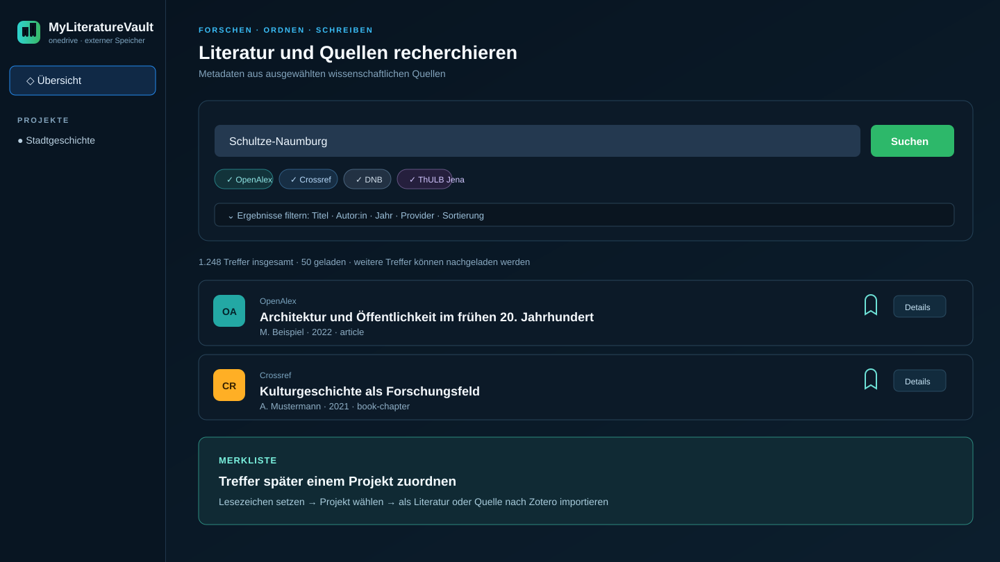
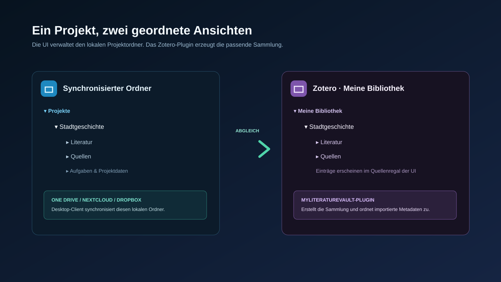
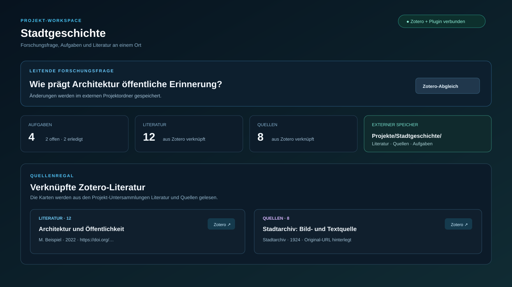

# MyLiteratureVault

MyLiteratureVault verbindet Ihre Forschungsprojekte, Zotero und einen lokalen
WebDAV-Speicher. Literatur, Quellen, Aufgaben und Projektordner bleiben dabei
auf Ihrem Rechner bzw. in Ihrem bereits synchronisierten Cloud-Ordner – nicht
in GitHub und nicht in Git LFS.

> Die folgenden Bilder sind anonymisierte Beispielansichten der Anwendung. Sie
> enthalten keine lokalen Pfade, Projekte oder Forschungsdaten.



## In drei Sätzen

1. Sie legen ein Forschungsprojekt in der Oberfläche an.
2. Das Zotero-Plugin erzeugt dazu unter **Meine Bibliothek** eine Sammlung mit
   **Literatur** und **Quellen**.
3. Sie recherchieren Metadaten, merken Treffer vor und importieren sie als
   Literatur oder Quelle in das gewählte Projekt.

## Schnellstart für Windows

### Was Sie vorher brauchen

- [Docker Desktop](https://www.docker.com/products/docker-desktop/)
- [Zotero 10](https://www.zotero.org/download/)
- Einen **lokalen** Ordner, den OneDrive, Nextcloud Desktop oder Dropbox bereits
  synchronisiert. Ein Freigabelink allein reicht nicht aus.

### 1. Starten

1. Dieses Repository herunterladen oder klonen.
2. Im Projektordner `quickstart.bat` doppelklicken.
3. Beim ersten Start Cloud-Anbieter und den lokalen, synchronisierten Ordner
   eingeben. Den vorgeschlagenen Ordner können Sie mit Enter übernehmen.
4. Warten, bis `Fertig! Alle Dienste laufen.` erscheint. Danach öffnet sich die
   Oberfläche unter <http://localhost:8765>.

Der erste Docker-Start darf etwas dauern: Das Skript wartet bis zu vier Minuten
auf Docker Desktop und danach bis zu zwei Minuten auf WebDAV. Währenddessen ist
`Container zotero-webdav Creating` normal. Erst wenn die Wartezeit abläuft,
zeigt das Skript Status und letzte Container-Logs als Fehlerhilfe.

### 2. Zotero einmalig verbinden

1. In Zotero **Bearbeiten → Einstellungen → Sync → Datei-Synchronisation**
   öffnen.
2. Als Methode **WebDAV** wählen.
3. Eintragen:

   ```text
   URL:       http://localhost:8080
   Benutzer:  zotero
   Passwort:  siehe .env.local (beim ersten Start: changeme123)
   ```

4. **Server prüfen** wählen.

Die Datei `.env.local` enthält Ihre lokale Konfiguration und wird nicht in Git
committet. Ändern Sie `ZOTERO_STORAGE_PATH` nur auf einen tatsächlich lokal
verfügbaren und von einem Cloud-Desktop-Client synchronisierten Ordner.

### 3. MyLiteratureVault-Plugin installieren

Das Plugin ist erforderlich, damit neu angelegte Projekte als Zotero-Sammlungen
erscheinen und Recherchetreffer importiert werden können.

1. Im Projektordner PowerShell öffnen und das Paket bauen:

   ```powershell
   powershell -NoProfile -ExecutionPolicy Bypass -File .\build-zotero-plugin.ps1
   ```

2. In Zotero **Extras → Erweiterungen → Zahnrad → Add-on aus Datei
   installieren…** wählen.
3. `dist\myliteraturevault-zotero.xpi` auswählen und Zotero neu starten.
4. In Zotero **Ansicht → MyLiteratureVault-Projekte mit Zotero
   synchronisieren** wählen.

Die Erweiterung ist Version **0.4.3** und für Zotero `10.0.*` vorgesehen. Sie
prüft beim Start und danach etwa alle 30 Sekunden, ob ein Abgleich ansteht.

## So benutzen Sie das Tool

### Projekt anlegen und mit Zotero prüfen

1. In der Übersicht **Neues Projekt** wählen und einen Projektnamen vergeben.
2. Öffnen Sie danach in Zotero **Meine Bibliothek**. Es sollte diese Struktur
   geben:

   ```text
   Meine Bibliothek/
     Ihr Projekt/
       Literatur/
       Quellen/
   ```

3. Fehlt die Sammlung, prüfen Sie, ob das Plugin aktiviert ist, starten Sie
   Zotero neu und führen Sie den Menüpunkt für den Projekt-Abgleich erneut aus.



### Literatur und Quellen recherchieren

1. In der Übersicht oder im Projekt-Workspace einen Suchbegriff eingeben.
2. Quellen aktivieren und die Trefferzahl wählen (25, 50 oder 100 pro Abruf).
3. Die Liste bei Bedarf mit **Weitere Treffer laden** erweitern. Die Anzeige
   nennt zusätzlich die von den Datenbanken gemeldete Gesamtzahl.
4. Bereits geladene Treffer nach Titel, Autor:in, Jahr oder Provider filtern
   und nach Titel, Autor:in, Jahr oder Provider sortieren.
5. **Details** zeigt die verfügbaren bibliografischen Metadaten; **Original**
   öffnet den Nachweis beim jeweiligen Provider.

Aktiv recherchierbar sind OpenAlex, Crossref, die Deutsche Nationalbibliothek
und der öffentliche ThULB-Jena-Katalog. JSTOR wird nicht gecrawlt: Sein XML
Gateway setzt eine institutionelle Metasearch-Vereinbarung voraus und bleibt
ohne diese Lizenz deaktiviert. Andere gekennzeichnete Anbieter sind externe
oder konfigurationsabhängige Ziele.

### Treffer merken und nach Zotero übernehmen

1. Auf das Lesezeichen-Symbol eines Treffers klicken. Der Treffer landet in der
   lokalen **Merkliste**.
2. In der Merkliste das Zielprojekt auswählen.
3. **Als Literatur** oder **Als Quelle** nach Zotero importieren wählen.
4. In Zotero erscheint der Eintrag in der passenden Projekt-Untersammlung.

Beim Import werden verfügbare Metadaten sowie Original- und gegebenenfalls
Volltext-URL übergeben. Bereits vorhandene DOI-Einträge werden wiederverwendet.
Geschützte PDFs werden weder heruntergeladen noch kopiert; ihre URL bleibt aber
als Nachweis verfügbar.



### Im Projekt weiterarbeiten

- Legen Sie Aufgaben und Forschungsfragen im Workspace ab.
- Fügen Sie eigene Titel direkt in Zotero unter **Literatur** oder **Quellen**
  hinzu. Die UI aktualisiert ihr Quellenregal ungefähr alle 30 Sekunden.
- Mit **Zotero-Abgleich anfordern** markieren Sie einen sofortigen Abgleich;
  das Plugin erledigt ihn beim nächsten Durchlauf.

## Wo liegen meine Daten?

```text
Synchronisierter Cloud-Ordner/
  Projekte/
    Ihr Projekt/
      Literatur/
      Quellen/
```

Dieser Ordner enthält Projektstatus, Aufgaben und lokale Zwischenspeicher. Ihr
Cloud-Desktop-Client übernimmt die Synchronisierung. Der mitgestartete
`auto-sync.ps1` ist nur ein Speicher-Aktivitätsmonitor und erzeugt keine
Git-Commits für Zotero-Dateien. Umbenennen oder Löschen von Projekten bzw.
Sammlungen geschieht bewusst nicht automatisch durch den Abgleich.

## Wenn etwas nicht funktioniert

| Problem | Erste Lösung |
| --- | --- |
| `Container zotero-webdav Creating` | Warten, bis der Quickstart die WebDAV-Prüfung beendet. Bei Ablauf: Docker Desktop öffnen und `quickstart.bat` erneut starten. |
| Oberfläche nicht erreichbar | `check-status.bat` ausführen; bei Bedarf `start-ui.bat` starten. |
| Projekt erscheint nicht in Zotero | Plugin aktivieren, Zotero neu starten, dann **Ansicht → MyLiteratureVault-Projekte mit Zotero synchronisieren** ausführen. |
| Treffer fehlen oder ein Provider meldet Fehler | Provider erneut versuchen oder andere Quelle aktivieren. Ergebnisse und Fehler eines Providers blockieren die übrigen nicht. |
| Keine Anhänge in GitHub | Das ist korrekt: Anhänge und Forschungsdaten bleiben im externen Speicher. |

## Nützliche Befehle

```powershell
# Dienste starten und UI öffnen
.\quickstart.bat

# Laufende Dienste und Git-Status prüfen
.\check-status.bat

# Nur die lokale UI starten
.\start-ui.bat

# Zotero-Plugin neu bauen
powershell -NoProfile -ExecutionPolicy Bypass -File .\build-zotero-plugin.ps1
```

## Technischer Überblick

| Bestandteil | Aufgabe |
| --- | --- |
| `quickstart.ps1` / `quickstart.bat` | Richtet die lokale Konfiguration ein und startet Docker, WebDAV, UI und Monitor. |
| `docker-compose.yml` | Bindet den externen Speicher als WebDAV-Volume ein. |
| `vault-ui.ps1` und `ui/` | Lokaler Server, Forschungsprojekt-UI und APIs. |
| `search/` | Suchdienst mit getrennten Adaptermodulen für die Provider. |
| `zotero-plugin/` | Quellcode der Zotero-Erweiterung. |
| `build-zotero-plugin.ps1` | Erzeugt `dist/myliteraturevault-zotero.xpi`. |

Weitere technische Details für die Erweiterung stehen in
[zotero-plugin/README.md](zotero-plugin/README.md).

## Transparenz zur Entwicklung

Bei der Konzeption und Weiterentwicklung dieses Tools wurden LLM-gestützte
Coding-Agenten als Unterstützung für Entwurf, Implementierung, Refactoring,
Tests und Dokumentation eingesetzt. Sie ersetzen weder die fachliche Prüfung
von Forschungsfragen und Metadaten noch die Verantwortung der Nutzenden für
ihre Daten, Lizenzen und wissenschaftlichen Aussagen.

## Datenschutz und Git-Grenzen

GitHub enthält nur den Quellcode dieses Repositories. `.gitignore` schützt
`.env.local`, Laufzeitprotokolle, den lokalen Fallback `data/` und die
generierte XPI-Datei. Zotero-Anhänge, private Forschungsprojektdateien und
lokale Zugänge gehören ausschließlich in den externen, synchronisierten
Speicher.
